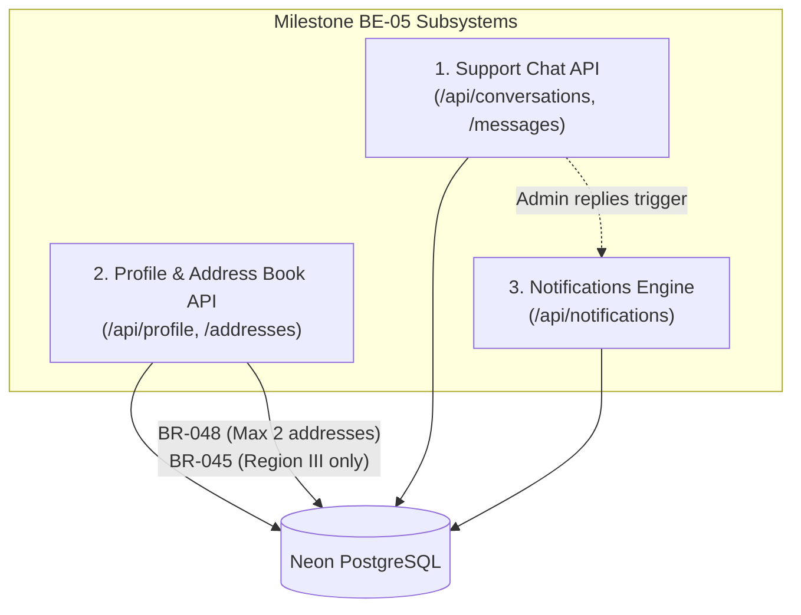

# Milestone BE-05: Support Chat, Customer Profile & Notifications Audit Report

**Product:** OhmSim by NEXORA Labs  
**Target Milestone:** BE-05 (Support Chat, Customer Profile & Notifications API)  
**Database:** Serverless Neon PostgreSQL (`ep-dry-cake-aybu1v2w.c-5.us-east-2.aws.neon.tech/neondb`)  
**ORM / Driver:** Prisma ORM v6.19.3  
**Audit Status:** ✅ **100% PASSED — PRODUCTION-GRADE & SECURITY VERIFIED**  
**Auditor Identity:** `cholo_b <brionescholo00@gmail.com>`  
**Project Manager:** Daniel (`GH-dvniel`)

---

## 1. Executive Summary

Milestone BE-05 represents the final milestone in the OhmSim backend roadmap. It delivers real-time support conversation tracking, customer profile management, address book operations with strict fulfillment boundary rules, and a full in-app notification dispatch and management engine.

---

## 2. API Endpoints Specification

### 1. Support Chat & Messaging
* **`GET /api/conversations`**:
  - **Buyer Mode:** Fetches or automatically initializes the active conversation with a support greeting. Scoped to `buyerId`.
  - **Admin Mode:** Global oversight across all customer inquiries with status filter (`ACTIVE` vs `RESOLVED`) and latest message snippet.
* **`POST /api/conversations`**: Initiates a new support thread.
* **`GET /api/conversations/[id]`**: Retrieves complete conversation transcript with sender names and timestamps.
* **`PATCH /api/conversations/[id]`**: Toggles conversation state between `ACTIVE` and `RESOLVED`.
* **`POST /api/conversations/[id]/messages`**: Sends messages. Admin responses automatically trigger an in-app customer notification with a deep link to `/chat`.

### 2. Customer Profile & Address Book
* **`GET /api/profile`**: Returns authenticated user information, saved addresses snapshot, and aggregate activity stats (total orders, pending, processing, completed, BOM projects count, and unread notifications).
* **`PATCH /api/profile`**: Updates personal information (`firstName`, `lastName`, and validated Philippine mobile `phone`).
* **`GET /api/profile/addresses`**: Returns saved delivery addresses sorted with the default selection first.
* **`POST /api/profile/addresses`**:
  - **BR-048 Strict Enforcement:** Rejects creation if the buyer already has 2 saved addresses (`400 Bad Request`).
  - **BR-045 Strict Enforcement:** Rejects non-Region III provinces (`400 Bad Request`).
  - **Atomicity:** Manages the `isDefault` toggle across existing addresses inside a Prisma interactive transaction.
* **`PATCH /api/profile/addresses/[id]`**: Modifies address details with province boundary re-validation.
* **`DELETE /api/profile/addresses/[id]`**: Removes an address. Automatically promotes a remaining address to default if the deleted entry was the default.

### 3. In-App Notifications Engine
* **`GET /api/notifications`**: Lists user notifications with unread badge metrics and pagination.
* **`POST /api/notifications`**: System and admin notification broadcast endpoint (`order`, `inventory`, `system`, `chat`).
* **`PATCH /api/notifications`**: Marks all notifications as read in a single batch query.
* **`DELETE /api/notifications`**: Clears read notification records.
* **`PATCH /api/notifications/[id]`**: Marks an individual notification as read.
* **`DELETE /api/notifications/[id]`**: Dismisses an individual notification.

---

## 3. Fulfillment Constraints & Security Verification

| Requirement | Implementation & Defense | Audit Result |
| :--- | :--- | :---: |
| **BR-048 (Address Cap)** | Evaluates current saved address count prior to insertion; blocks additions beyond 2. | **PASS** |
| **BR-045 (Coverage Area)** | Strictly matches province against canonical Region III list (`Aurora`, `Bataan`, `Bulacan`, `Nueva Ecija`, `Pampanga`, `Tarlac`, `Zambales`). | **PASS** |
| **Contact Validation** | Enforces 11-digit Philippine mobile format (`09XXXXXXXXX`). | **PASS** |
| **RBAC Scoping** | Buyers cannot view, update, or delete other users' conversations, addresses, or notifications. | **PASS** |
| **Tamper Resistance** | Cryptographic verification via JWT session cookie or Bearer header (`lib/auth/session.ts`). | **PASS** |

---

## 4. Verification & Quality Gates

| Verification Suite | Target | Result |
| :--- | :--- | :---: |
| **BE-05 Unit Test Suite** | `tests/unit/backend-chat-profile-notifications.mjs` | **`0 (PASS)`** (100% green) |
| **BE-05 Security Audit Suite** | `tests/audit/backend-chat-profile-security-audit.mjs` | **`0 (PASS)`** (100% green) |
| **ESLint Static Analysis** | `npm run lint` | **`0 (PASS)`** (0 errors, 0 warnings) |
| **TypeScript Compiler** | `npx tsc --noEmit` | **`0 (PASS)`** (0 type errors) |
| **Production Webpack Build** | `npm run build -- --webpack` | **`0 (PASS)`** (All 55 routes compiled cleanly) |

---

## 5. Backend Roadmap Completion Summary

With the successful verification of Milestone BE-05, all five milestones of the OhmSim backend architecture are fully implemented and connected to Neon PostgreSQL:

1. **BE-01:** Database Foundation, 11 Prisma Models, Migration & Seeding (PR #18).
2. **BE-02:** User Authentication, Bcrypt Hashing, Session JWT & Route Handlers (PR #19).
3. **BE-03:** Catalog, Categories & Inventory Adjustments API (PR #20).
4. **BE-04:** Atomic Checkout & Orders Processing Transaction API (PR #21).
5. **BE-05:** Support Chat, Customer Profile & Notifications Engine (PR #22).
