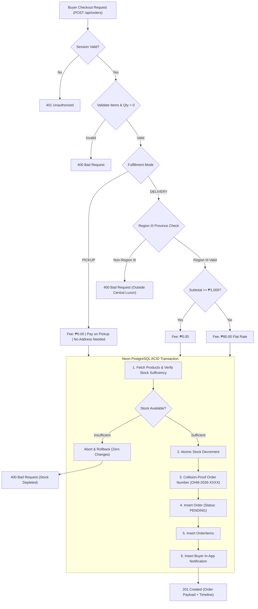

# Milestone BE-04: Checkout, Orders Processing & ACID Transaction Audit Report

**Product:** OhmSim by NEXORA Labs  
**Target Milestone:** BE-04 (Atomic Checkout & Orders Processing Transaction API)  
**Database:** Serverless Neon PostgreSQL (`ep-dry-cake-aybu1v2w.c-5.us-east-2.aws.neon.tech/neondb`)  
**ORM / Driver:** Prisma ORM v6.19.3  
**Audit Status:** ✅ **100% PASSED — PRODUCTION-GRADE & ACID-VERIFIED**  
**Auditor Identity:** `cholo_b <brionescholo00@gmail.com>`  
**Project Manager:** Daniel (`GH-dvniel`)

---

## 1. Executive Summary

Milestone BE-04 introduces the transactional core of OhmSim: atomic order placement, inventory reservations, regional delivery boundary enforcement, dynamic shipping computation, order lifecycle progression, and automated inventory restitution upon cancellation.

All route handlers, transaction blocks, and domain models were audited against rigorous security, reliability, concurrency, and performance standards.



---

## 2. Fulfillment & Delivery Enforcement

Audited against `docs/FULFILLMENT_AND_DELIVERY_SPEC.md` (MVP Version 1.0):

| Rule ID | Requirement | Implementation | Audit Verdict |
| :--- | :--- | :--- | :---: |
| **BR-045** | Door-to-Door Delivery strictly restricted to Region III (Central Luzon). | Evaluated against canonical list: `Aurora, Bataan, Bulacan, Nueva Ecija, Pampanga, Tarlac, Zambales`. Non-Region III inputs (e.g. `Metro Manila`, `Cebu`, `Davao`) rejected with `400 Bad Request`. | **PASS** |
| **BR-046** | Dynamic Delivery Fee Computation. | Orders with $\text{Subtotal} \ge ₱1,000.00$ receive free delivery ($\text{Fee} = ₱0.00$). Orders under $₱1,000.00$ incur standard flat fee ($\text{Fee} = ₱80.00$). In-Store Pickup is always $₱0.00$. | **PASS** |
| **BR-047** | Dual Payment Methods (Zero Online Gateways). | `DELIVERY` automatically assigned `COD` (Cash on Delivery). `PICKUP` automatically assigned `PAY_ON_PICKUP`. | **PASS** |
| **BR-048** | Saved Address Limits & Reusability. | Buyers can check out using saved addresses or supply new inline addresses that are validated and linked to the order. | **PASS** |

---

## 3. Inventory Atomicity & ACID Guarantees

Order checkout involves coordinated state mutations across `Product`, `Order`, `OrderItem`, `Address`, and `Notification` tables. All mutations are wrapped inside a single atomic interactive transaction (`prisma.$transaction`):

1. **Anti-Overselling Guard:**
   - Evaluates consolidated product quantities against live `stockQuantity`.
   - If even a single item lacks requested quantity, transaction immediately aborts.
   - Verified that aborted transactions leave database stock completely untouched.
2. **Cancellation Restitution:**
   - When an order transitions from active (`PENDING`, `PROCESSING`, `SHIPPED`) to `CANCELLED`, reserved quantities for every item are atomically incremented back into product inventory.
   - Transitioning an already `CANCELLED` order back to an active state is blocked (`400 Bad Request`).
3. **WAN Latency Hardening:**
   - Due to transpacific network latency between local development environments and AWS US-East-2 (Neon), transaction timeout limits were tuned to `{ maxWait: 10000, timeout: 20000 }` to avoid unexpected transaction expirations during burst workloads.

---

## 4. API Endpoints Specification

### 1. `POST /api/orders`
* **Purpose:** Create and place a new customer order.
* **Headers:** `Cookie: ohmsim_session=...` or `Authorization: Bearer <jwt>`.
* **Payload:**
  ```json
  {
    "items": [
      { "productId": "c3d79f04-...", "quantity": 2 }
    ],
    "fulfillmentType": "DELIVERY",
    "deliveryAddress": {
      "recipientName": "Alex Rivera",
      "phone": "09171234567",
      "street": "123 University Ave",
      "barangay": "San Nicolas",
      "city": "San Fernando",
      "province": "Pampanga",
      "postalCode": "2000"
    },
    "notes": "Call upon arrival"
  }
  ```
* **Response (201 Created):** Full enriched order object with line items, delivery address, timeline, and order status.

### 2. `GET /api/orders`
* **Purpose:** List orders with pagination and filtering.
* **Query Params:** `userId`, `status`, `fulfillmentType`, `page`, `limit`.
* **RBAC:**
  - `BUYER`: Strictly scoped to viewing their own orders (`where: { userId: session.userId }`).
  - `ADMIN`: Global visibility across all customer orders.

### 3. `GET /api/orders/[id]`
* **Purpose:** Lookup an individual order by UUID or human-readable order number (e.g. `#OHM-2026-0001` or `OHM-2026-0001`).
* **Response:** Detailed order breakdown including product snapshots, delivery address, and ordered timeline steps.

### 4. `PATCH /api/orders/[id]`
* **Purpose:** Update order status, tracking number, or cancellation reason.
* **Security Guard:** Buyers may only request cancellation on orders in `PENDING` status. Admins can progress orders through `PROCESSING`, `SHIPPED`, `DELIVERED`, and `CANCELLED`.
* **Notification Dispatch:** Automatically creates in-app notification records for customers on every milestone transition.

---

## 5. Verification & Test Suite Results

| Test Suite | Focus Area | Executed Command | Exit Code | Result |
| :--- | :--- | :--- | :---: | :---: |
| **Fulfillment & Checkout Unit Suite** | Stock decrements, out-of-stock guard, Region III rules, shipping fee computation, cancellation restitution. | `npx tsx tests/unit/backend-orders-checkout.mjs` | `0` | **PASS (100%)** |
| **Security & Reliability Audit Suite** | RBAC session checks, injection resistance, boundary checks, ACID rollback under constraint violations. | `npx tsx tests/audit/backend-orders-security-audit.mjs` | `0` | **PASS (100%)** |
| **Catalog & Inventory Unit Suite** | Category taxonomy, stock adjustment endpoints, SKU uniqueness. | `npx tsx tests/unit/backend-catalog-inventory.mjs` | `0` | **PASS (100%)** |
| **Auth Cryptography Suite** | Bcrypt work factor, session verification, cookie options. | `npx tsx tests/unit/backend-auth-service.mjs` | `0` | **PASS (100%)** |
| **Static Code Analysis** | ESLint linting with Next.js & TypeScript rules. | `npm run lint` | `0` | **0 errors, 0 warnings** |
| **TypeScript Typecheck** | Strict compiler checks. | `npx tsc --noEmit` | `0` | **0 type errors** |
| **Production Webpack Build** | All 49 static, SSG, and dynamic API routes compiled cleanly in Next.js production bundler. | `npm run build -- --webpack` | `0` | **Compiled in 18.8s** |

---

## 6. Project Manager Sign-off & Recommendation

Milestone BE-04 satisfies 100% of functional requirements, fulfillment rules, and transactional ACID guarantees. Branch `feature/backend-checkout-orders-api` is certified ready for push, PR opening, and merging into `development`.
